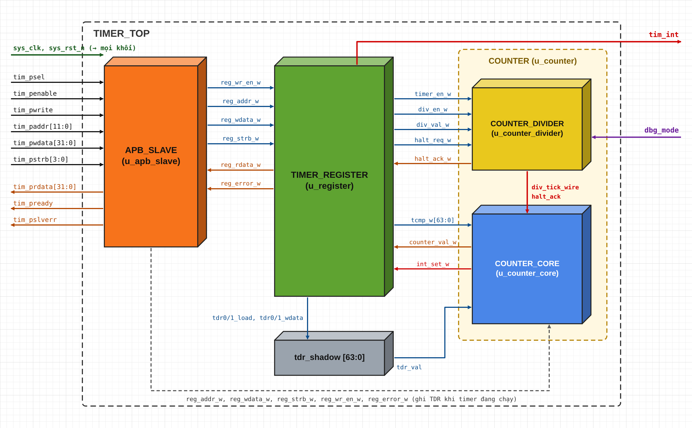

A robust, configurable 64-bit Timer IP with an AMBA APB slave interface, programmable prescaler, compare interrupt and debug-halt capabilities, implemented in Verilog.

---

### 📌 Features

*   **Core Architecture:** Modular RTL design featuring independent APB Slave Interface (`apb_slave`), Register Bank (`timer_register`), Timer Divider (`counter_divider`) and Timer Core (`counter_core`) blocks, integrated in a single clock domain inside the top module `timer_top`.
*   **AMBA APB Interface:** 12-bit address, 32-bit data, byte-lane writes with `PSTRB`, one wait state per transfer (`PREADY`, 3 clock cycles per transaction) and `PSLVERR` error response for rejected writes.
*   **64-bit Counter & Compare Interrupt:** 64-bit up-counter accessed through `TDR0`/`TDR1`, 64-bit compare value `TCMP1:TCMP0`, latched interrupt flag with Write-1-to-Clear (`TISR`) and interrupt mask (`TIER`): `tim_int = int_st & int_en`.
*   **Programmable Prescaler & Debug Halt:** Clock-enable divider `2^div_val` (`div_val` = 0..7, divide by 1 to 128) with protected configuration (values 8..15 and changes while the timer is running are rejected), and debug halt handshake `halt_ack = dbg_mode & halt_req` that freezes both the divider and the counter.
*   **Verification:** Comprehensive self-checking Verilog testbench (`timer_top_tb.v`) running in ModelSim, plus unit testbenches (`register_tb.v`, `counter_tb.v`, `app_slave_tb.v`), utilizing a Golden Model (`GOLDEN_MODEL.v`, ported from the Python `GOLDEN_MODEL.py`) for automated self-checking and cycle-by-cycle scoreboard comparison.

---

### 📁 Repository Structure

*   `SRC/` : Verilog RTL source codes (`timer_top.v`, `app_slave.v`, `register.v`, `counter.v`) and Testbench environment (`timer_top_tb.v`, `register_tb.v`, `counter_tb.v`, `app_slave_tb.v`, `GOLDEN_MODEL.v`) with ModelSim run scripts (`run_*.do`).
*   `REPORT/` : Comprehensive project documentation (`Report IP Timer.pdf`), architectural block diagrams, and waveform results.

---

### 📖 Documentation

Detailed specifications, parameter configurations, and simulation verification reports are available in the [REPORT/](REPORT/) directory.

# PROJECT IP TIMER

- Khối module top TIMER_TOP

<!-- Kéo thả hình ảnh sơ đồ TIMER_TOP của bạn vào dòng dưới đây để thay thế link -->

---

Danh sách tín hiệu I/O các module

## Mục lục

* [TIMER_TOP](#timer_top)
* [APB_SLAVE](#apb_slave)
* [TIMER_REGISTER](#timer_register)
* [COUNTER_DIVIDER](#counter_divider)
* [COUNTER_CORE](#counter_core)

---

### TIMER_TOP

File: `timer_top.v`

| Tín hiệu | Hướng | Kiểu/Độ rộng | Ghi chú |
| :--- | :--- | :--- | :--- |
| sys_clk | input | wire | Clock hệ thống |
| sys_rst_n | input | wire | Reset bất đồng bộ toàn IP, active-low |
| tim_psel | input | wire | Chọn slave, bắt đầu giao dịch APB |
| tim_penable | input | wire | Báo hiệu pha ACCESS của APB |
| tim_pwrite | input | wire | Chiều giao dịch: 1 = ghi, 0 = đọc |
| tim_paddr | input | wire [11:0] | Địa chỉ thanh ghi (offset byte) |
| tim_pwdata | input | wire [31:0] | Dữ liệu ghi |
| tim_pstrb | input | wire [3:0] | Byte strobe của lệnh ghi |
| tim_prdata | output | wire [31:0] | Dữ liệu đọc |
| tim_pready | output | wire | Slave hoàn tất giao dịch (sau 1 chu kỳ chờ) |
| tim_pslverr | output | wire | Báo lỗi lệnh ghi TCR bị từ chối |
| dbg_mode | input | wire | Hệ thống đang ở chế độ gỡ lỗi |
| tim_int | output | wire | Ngắt gửi tới CPU (int_st & int_en) |

 

### APB_SLAVE

File: `app_slave.v`

| Tín hiệu | Hướng | Kiểu/Độ rộng | Ghi chú |
| :--- | :--- | :--- | :--- |
| sys_clk | input | wire | Clock hệ thống |
| sys_rst_n | input | wire | Reset, active-low |
| tim_psel | input | wire | Chọn slave |
| tim_penable | input | wire | Báo hiệu pha ACCESS |
| tim_pwrite | input | wire | Chiều giao dịch: 1 = ghi, 0 = đọc |
| tim_paddr | input | wire [11:0] | Địa chỉ thanh ghi |
| tim_pwdata | input | wire [31:0] | Dữ liệu ghi |
| tim_pstrb | input | wire [3:0] | Byte strobe của lệnh ghi |
| tim_prdata | output | wire [31:0] | Dữ liệu đọc, nối trực tiếp từ reg_rdata |
| tim_pready | output | wire | Báo hoàn tất giao dịch (apb_access & access_seen) |
| tim_pslverr | output | wire | Báo lỗi lệnh ghi (tim_pready & tim_pwrite & reg_error) |
| reg_valid | output | wire | Yêu cầu đọc/ghi đã hoàn tất (= tim_pready) |
| reg_write | output | wire | Chiều ghi của yêu cầu |
| reg_addr | output | wire [11:0] | Địa chỉ chuyển sang khối thanh ghi |
| reg_wdata | output | wire [31:0] | Dữ liệu ghi chuyển sang khối thanh ghi |
| reg_strb | output | wire [3:0] | Byte strobe chuyển sang khối thanh ghi |
| reg_rdata | input | wire [31:0] | Dữ liệu đọc từ khối thanh ghi |
| reg_error | input | wire | Lỗi ghi do khối thanh ghi phát hiện |

 

### TIMER_REGISTER

File: `register.v`

| Tín hiệu | Hướng | Kiểu/Độ rộng | Ghi chú |
| :--- | :--- | :--- | :--- |
| sys_clk | input | wire | Clock hệ thống |
| sys_rst_n | input | wire | Reset, active-low |
| reg_wr_en | input | wire | Lệnh ghi APB đã hoàn tất |
| reg_addr | input | wire [11:0] | Địa chỉ thanh ghi |
| reg_wdata | input | wire [31:0] | Dữ liệu ghi |
| reg_pstrb | input | wire [3:0] | Byte strobe |
| reg_rdata | output | reg [31:0] | Dữ liệu đọc theo địa chỉ (tổ hợp) |
| reg_err | output | wire | Lỗi ghi TCR (div_val 8..15 hoặc thay đổi khi đang chạy) |
| timer_en | output | wire | TCR[0] – bật bộ đếm |
| div_en | output | wire | TCR[1] – bật bộ chia tần |
| div_val | output | wire [3:0] | TCR[11:8] – hệ số chia 2^div_val |
| tcmp | output | wire [63:0] | Giá trị so sánh {TCMP1, TCMP0} |
| int_en | output | wire | TIER[0] – cho phép ngắt |
| halt_req | output | wire | THCSR[0] – yêu cầu dừng khi gỡ lỗi |
| tim_int | output | wire | Ngõ ra ngắt: r_int_st & r_int_en |
| tdr0_load | output | wire | Xung ghi TDR0 |
| tdr0_wdata | output | wire [31:0] | Dữ liệu TDR0 đã gộp theo byte strobe |
| tdr1_load | output | wire | Xung ghi TDR1 |
| tdr1_wdata | output | wire [31:0] | Dữ liệu TDR1 đã gộp theo byte strobe |
| tdr0_rdata | input | wire [31:0] | Giá trị bộ đếm hiện tại bit [31:0] (đọc TDR0) |
| tdr1_rdata | input | wire [31:0] | Giá trị bộ đếm hiện tại bit [63:32] (đọc TDR1) |
| int_set | input | wire | Sự kiện so sánh từ khối counter |
| halt_ack | input | wire | Trạng thái dừng gỡ lỗi từ khối counter |

 

### COUNTER_DIVIDER

File: `counter.v`

| Tín hiệu | Hướng | Kiểu/Độ rộng | Ghi chú |
| :--- | :--- | :--- | :--- |
| sys_clk | input | wire | Clock hệ thống |
| sys_rst_n | input | wire | Reset, active-low |
| timer_en | input | wire | Cho phép timer; = 0 thì xóa div_cnt |
| div_en | input | wire | Cho phép chia tần |
| div_val | input | wire [3:0] | Hệ số chia: tick sau mỗi 2^div_val chu kỳ |
| dbg_mode | input | wire | Hệ thống đang ở chế độ gỡ lỗi |
| halt_req | input | wire | Yêu cầu dừng từ THCSR |
| halt_ack | output | wire | dbg_mode & halt_req |
| div_tick | output | wire | Xung cho phép đếm rộng 1 chu kỳ (không tạo clock mới) |

 

### COUNTER_CORE

File: `counter.v`

| Tín hiệu | Hướng | Kiểu/Độ rộng | Ghi chú |
| :--- | :--- | :--- | :--- |
| sys_clk | input | wire | Clock hệ thống |
| sys_rst_n | input | wire | Reset, active-low |
| reg_addr | input | wire [11:0] | Địa chỉ ghi (0x004: TDR0, 0x008: TDR1) |
| reg_wdata | input | wire [31:0] | Dữ liệu ghi TDR |
| reg_wstrb | input | wire [3:0] | Byte strobe ghi TDR |
| wr_en | input | wire | Lệnh ghi hoàn tất |
| has_error | input | wire | Lệnh ghi bị lỗi |
| timer_en | input | wire | = 0: bộ đếm lấy giá trị tdr_val |
| div_tick | input | wire | Xung cho phép đếm từ counter_divider |
| halt_ack | input | wire | Dừng đếm khi gỡ lỗi |
| tcmp_val | input | wire [63:0] | Giá trị so sánh |
| tdr_val | input | wire [63:0] | Giá trị TDR đã lập trình (tdr_shadow) |
| counter_val | output | reg [63:0] | Giá trị bộ đếm (đọc qua TDR0/TDR1) |
| cmp_match_evt | output | wire | Mức 1 khi counter_val == tcmp_val |
