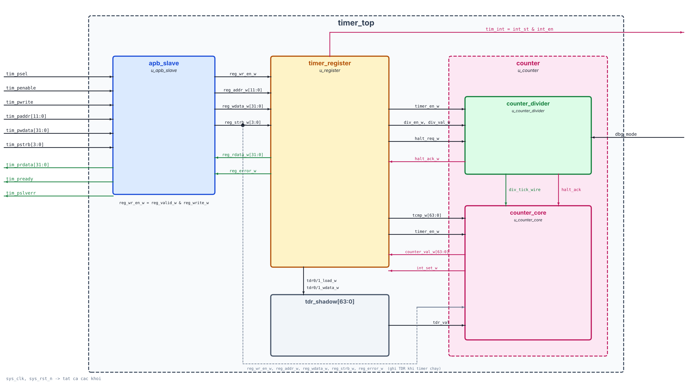
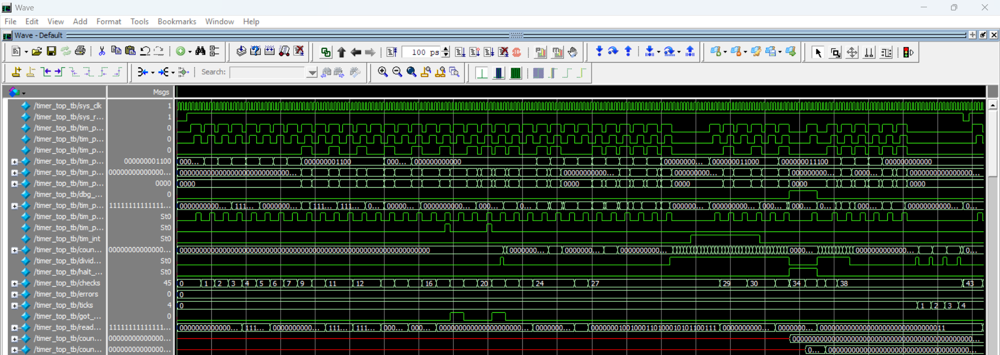

A 64-bit Timer IP with an AMBA APB slave interface, programmable prescaler, compare interrupt and debug-halt support, implemented in Verilog-2001.

---

### 📌 Features

*   **Core Architecture:** Modular RTL design featuring an APB front-end (`apb_slave`), a register bank (`timer_register`) and a counter subsystem (`counter` = `counter_divider` + `counter_core`), integrated in the top module `timer_top`.
*   **AMBA APB Slave:** 12-bit byte address, 32-bit data, byte strobes `tim_pstrb[3:0]`, one wait state (`tim_pready`), error response `tim_pslverr` for rejected TCR writes. Reserved addresses read as zero and ignore writes.
*   **64-bit Count-up Timer:** `TDR1:TDR0` readable and writable through APB (byte strobes supported). While `timer_en = 0` the counter follows the programmed TDR value (`tdr_shadow`).
*   **Prescaler:** `div_en = 0` → one count per `sys_clk`; `div_en = 1` → one count every `2^div_val` clocks (`div_val = 0..7`). `div_val = 8..15` is rejected, and `div_en`/`div_val` are locked while `timer_en = 1`.
*   **Compare Interrupt:** 64-bit compare `TCMP1:TCMP0`, latched status `TISR.int_st` (RW1C), `tim_int = int_st & int_en`.
*   **Debug Halt:** `halt_ack = dbg_mode & halt_req` freezes both the prescaler and the 64-bit counter.
*   **Verification:** Self-checking Verilog testbench (`timer_top_tb.v`) running in ModelSim: 8 test groups, **45 checks, 0 errors**.

---

### 📁 Repository Structure

*   `SRC/` : Verilog RTL source codes (`timer_top.v`, `apb_slave.v`, `register.v`, `counter.v`), testbench (`timer_top_tb.v`), reference model (`GOLDEN_MODEL.py`), ModelSim project and script (`TONG_HOP_CODE_IP_TIMER.mpf`, `run.do`).
*   `REPORT/` : Final report (`Final_Report_IP_Timer.docx` / `.pdf`), block diagrams and ModelSim waveform results (`REPORT/images/`).

---

### 📖 Documentation

Detailed specifications, register map, block diagrams and ModelSim simulation results are available in the [REPORT/](REPORT/) directory.

---

### 👥 Team Members

| No. | Full name | Student ID | Assigned responsibility |
| :--- | :--- | :--- | :--- |
| 1 | Phùng Văn Tân | SE203222 | Timer Divider (`counter_divider` – `counter.v`) |
| 2 | Hoàng Trung Hiếu | SE203208 | APB Slave Interface (`apb_slave.v`) |
| 3 | Hoàng Quốc Trí | SE203836 | System Integration and Verification (`timer_top.v`, `timer_top_tb.v`) |
| 4 | Lê Dương Hoàng Khang | SE204508 | Timer Core (`counter_core` – `counter.v`) |
| 5 | Trần Định Quốc | CE202008 | Register Bank (`register.v`) |

Lecturer: Phạm Thế Vinh — Class: IC2007 — FAP201 Final Project.

# PROJECT IP TIMER

- Khối module top timer_top



---

Danh sách tín hiệu I/O các module

## Mục lục

* [timer_top](#timer_top)
* [apb_slave](#apb_slave)
* [timer_register](#timer_register)
* [counter](#counter)
* [counter_divider](#counter_divider)
* [counter_core](#counter_core)
* [Bản đồ thanh ghi (Register Map)](#bản-đồ-thanh-ghi-register-map)
* [Mô phỏng trên ModelSim](#mô-phỏng-trên-modelsim)

---

### timer_top

File: `timer_top.v`

| Tín hiệu | Hướng | Kiểu/Độ rộng | Ghi chú |
| :--- | :--- | :--- | :--- |
| sys_clk | input | wire | Clock hệ thống |
| sys_rst_n | input | wire | Reset bất đồng bộ, active-low |
| tim_psel | input | wire | APB select |
| tim_penable | input | wire | APB enable (pha ACCESS) |
| tim_pwrite | input | wire | 1 = ghi, 0 = đọc |
| tim_paddr | input | wire [11:0] | Địa chỉ thanh ghi (offset byte) |
| tim_pwdata | input | wire [31:0] | Dữ liệu ghi |
| tim_pstrb | input | wire [3:0] | Byte strobe khi ghi |
| tim_prdata | output | wire [31:0] | Dữ liệu đọc |
| tim_pready | output | wire | Slave hoàn tất giao dịch (1 wait state) |
| tim_pslverr | output | wire | Báo lỗi lệnh ghi TCR bị từ chối |
| dbg_mode | input | wire | Hệ thống đang ở Debug mode |
| tim_int | output | wire | Ngắt ra CPU (`int_st & int_en`) |

<br>

### apb_slave

File: `apb_slave.v`

| Tín hiệu | Hướng | Kiểu/Độ rộng | Ghi chú |
| :--- | :--- | :--- | :--- |
| sys_clk | input | wire | Clock hệ thống |
| sys_rst_n | input | wire | Reset, active-low |
| tim_psel, tim_penable, tim_pwrite | input | wire | Tín hiệu điều khiển APB |
| tim_paddr | input | wire [11:0] | Địa chỉ APB |
| tim_pwdata | input | wire [31:0] | Dữ liệu ghi APB |
| tim_pstrb | input | wire [3:0] | Byte strobe APB |
| tim_prdata | output | wire [31:0] | Dữ liệu đọc (`= reg_rdata`) |
| tim_pready | output | wire | `psel & penable & access_seen` (1 wait state) |
| tim_pslverr | output | wire | `tim_pready & tim_pwrite & reg_error` |
| reg_valid | output | wire | Yêu cầu hợp lệ (`= tim_pready`) |
| reg_write | output | wire | Chiều giao dịch (`= tim_pwrite`) |
| reg_addr | output | wire [11:0] | Địa chỉ sang khối thanh ghi |
| reg_wdata | output | wire [31:0] | Dữ liệu ghi sang khối thanh ghi |
| reg_strb | output | wire [3:0] | Byte strobe sang khối thanh ghi |
| reg_rdata | input | wire [31:0] | Dữ liệu đọc từ khối thanh ghi |
| reg_error | input | wire | Lỗi ghi từ khối thanh ghi |

<br>

### timer_register

File: `register.v` (tham số `ADDR_W = 12`)

| Tín hiệu | Hướng | Kiểu/Độ rộng | Ghi chú |
| :--- | :--- | :--- | :--- |
| sys_clk | input | wire | Clock hệ thống |
| sys_rst_n | input | wire | Reset, active-low |
| reg_wr_en | input | wire | Lệnh ghi APB đã hoàn tất |
| reg_addr | input | wire [11:0] | Địa chỉ thanh ghi |
| reg_wdata | input | wire [31:0] | Dữ liệu ghi |
| reg_pstrb | input | wire [3:0] | Byte strobe |
| reg_rdata | output | reg [31:0] | Dữ liệu đọc (tổ hợp theo địa chỉ) |
| reg_err | output | wire | Ghi TCR không hợp lệ (div_val 8..15 / đổi cấu hình khi đang chạy) |
| timer_en, div_en | output | wire | TCR.timer_en, TCR.div_en |
| div_val | output | wire [3:0] | TCR.div_val |
| tcmp | output | wire [63:0] | `{TCMP1, TCMP0}` |
| int_en, halt_req | output | wire | TIER.int_en, THCSR.halt_req |
| tim_int | output | wire | `r_int_st & r_int_en` |
| tdr0_load, tdr1_load | output | wire | Xung ghi TDR0 / TDR1 |
| tdr0_wdata, tdr1_wdata | output | wire [31:0] | Dữ liệu TDR đã gộp theo byte strobe |
| tdr0_rdata, tdr1_rdata | input | wire [31:0] | Giá trị bộ đếm hiện tại (đọc TDR) |
| int_set | input | wire | Sự kiện so sánh từ bộ đếm |
| halt_ack | input | wire | Trạng thái dừng gỡ lỗi |

<br>

### counter

File: `counter.v` — khối bao gồm hai instance `u_counter_divider` và `u_counter_core`.

| Tín hiệu | Hướng | Kiểu/Độ rộng | Ghi chú |
| :--- | :--- | :--- | :--- |
| sys_clk, sys_rst_n | input | wire | Clock, reset active-low |
| reg_addr / reg_wdata / reg_wstrb | input | wire [11:0] / [31:0] / [3:0] | Yêu cầu ghi APB (ghi trực tiếp TDR khi timer chạy) |
| wr_en, has_error | input | wire | Lệnh ghi hoàn tất, lỗi ghi |
| timer_en, div_en | input | wire | Cấu hình TCR |
| div_val | input | wire [3:0] | Hệ số chia |
| tcmp_val | input | wire [63:0] | Giá trị so sánh |
| tdr_val | input | wire [63:0] | Giá trị TDR đã lập trình (`tdr_shadow`) |
| dbg_mode, halt_req | input | wire | Điều kiện dừng gỡ lỗi |
| halt_ack | output | wire | `dbg_mode & halt_req` |
| counter_val | output | wire [63:0] | Giá trị bộ đếm |
| cmp_match_evt | output | wire | `counter_val == tcmp_val` |

<br>

### counter_divider

File: `counter.v`

| Tín hiệu | Hướng | Kiểu/Độ rộng | Ghi chú |
| :--- | :--- | :--- | :--- |
| sys_clk, sys_rst_n | input | wire | Clock, reset active-low |
| timer_en | input | wire | Cho phép timer; = 0 thì xóa `div_cnt` |
| div_en | input | wire | Cho phép chia tần |
| div_val | input | wire [3:0] | Ngưỡng `div_limit = 2^div_val − 1` |
| dbg_mode, halt_req | input | wire | Điều kiện dừng gỡ lỗi |
| halt_ack | output | wire | `dbg_mode & halt_req` |
| div_tick | output | wire | `timer_en & ~is_halted & (~div_en \| div_match)` |

<br>

### counter_core

File: `counter.v`

| Tín hiệu | Hướng | Kiểu/Độ rộng | Ghi chú |
| :--- | :--- | :--- | :--- |
| sys_clk, sys_rst_n | input | wire | Clock, reset active-low |
| reg_addr / reg_wdata / reg_wstrb | input | wire [11:0] / [31:0] / [3:0] | Ghi TDR0 (0x004) / TDR1 (0x008) theo byte |
| wr_en, has_error | input | wire | Lệnh ghi hoàn tất, lỗi ghi |
| timer_en | input | wire | = 0: bộ đếm theo `tdr_val` |
| div_tick | input | wire | Xung cho phép đếm |
| halt_ack | input | wire | Dừng đếm khi gỡ lỗi |
| tcmp_val | input | wire [63:0] | Giá trị so sánh |
| tdr_val | input | wire [63:0] | Giá trị TDR đã lập trình |
| counter_val | output | reg [63:0] | Bộ đếm 64-bit |
| cmp_match_evt | output | wire | Mức 1 khi `counter_val == tcmp_val` |

<br>

### Bản đồ thanh ghi (Register Map)

| Offset | Tên | Bit | Truy cập | Reset | Mô tả |
| :--- | :--- | :--- | :--- | :--- | :--- |
| 0x000 | TCR | [0] timer_en, [1] div_en, [11:8] div_val | RW | 0x0000_0000 | Điều khiển timer; div_val 0..7 hợp lệ, 8..15 bị từ chối |
| 0x004 | TDR0 | [31:0] | RW | 0x0000_0000 | Bộ đếm bit [31:0] |
| 0x008 | TDR1 | [31:0] | RW | 0x0000_0000 | Bộ đếm bit [63:32] |
| 0x00C | TCMP0 | [31:0] | RW | 0xFFFF_FFFF | Giá trị so sánh bit [31:0] |
| 0x010 | TCMP1 | [31:0] | RW | 0xFFFF_FFFF | Giá trị so sánh bit [63:32] |
| 0x014 | TIER | [0] int_en | RW | 0x0000_0000 | Cho phép ngắt |
| 0x018 | TISR | [0] int_st | RW1C | 0x0000_0000 | Trạng thái ngắt, ghi 1 (byte 0) để xóa |
| 0x01C | THCSR | [0] halt_req (RW), [1] halt_ack (RO) | RW/RO | 0x0000_0000 | Điều khiển debug halt |
| khác | — | — | — | 0 | Reserved: đọc = 0, ghi bị bỏ qua, không báo lỗi |

<br>

### Mô phỏng trên ModelSim

1. Mở ModelSim → `File > Change Directory...` → chọn thư mục `SRC/` (hoặc mở project `SRC/TONG_HOP_CODE_IP_TIMER.mpf`).
2. Gõ trong cửa sổ Transcript:

```tcl
do run.do
```

3. Kết quả trong Transcript:

```
============================================================
 TIMER IP TEST SUMMARY: 45 checks, 0 failures
 RESULT: ALL TESTS PASSED
============================================================
```

> Lưu ý: chỉ nạp **một** top-level là testbench `timer_top_tb` (script `run.do` đã làm sẵn). Nếu nạp thêm `timer_top`, `timer_register`, `counter`, `apb_slave` như các top-level riêng, tín hiệu của chúng sẽ hiện `HiZ`/`StX` vì không được nối với testbench.

Waveform mô phỏng trên ModelSim (các tín hiệu của `timer_top_tb`, 0 – 2,33 µs):


